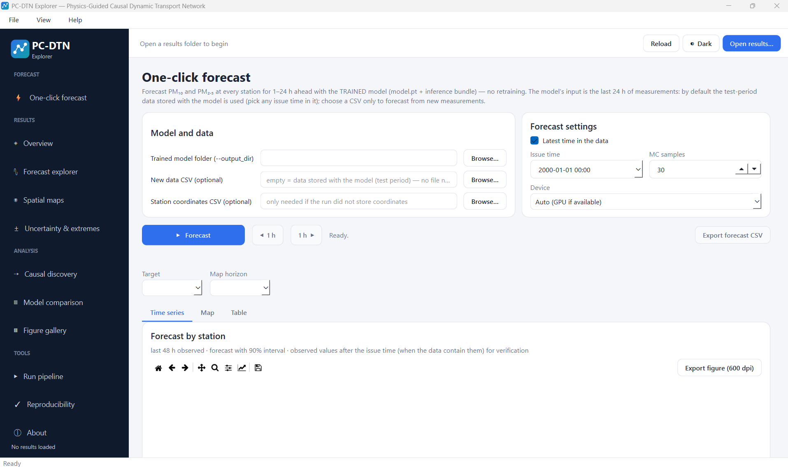

# PC-DTN: Physics-Guided Causal Dynamic Transport Network

## Overview

**PC-DTN** is research software for regime-aware, multi-horizon, multi-station short-term forecasting of **PM10 and PM2.5**. It combines three ingredients in one pipeline:

- a **regime-specific causal discovery** step that learns one causal DAG per meteorological regime,
- a **physics-based transport graph** between monitoring stations, driven by wind direction and station distance,
- a **dynamic graph forecaster** that issues forecasts for horizons of 1–24 h with predictive intervals and extreme-event probabilities.

The package contains the full training and evaluation pipeline, an inference tool that forecasts new data with a trained model without retraining, and a desktop GUI (**PC-DTN Explorer**) for inspecting every result.

## Key Capabilities

- **Multi-horizon forecasting**
  - PM10 and PM2.5 at every station, horizons 1–24 h
  - 90% predictive intervals and probability of exceeding each station's extreme threshold

- **Regime-aware causal discovery**
  - One causal DAG per network regime: normal, high wind, stagnation, rainfall, Extreme-PM
  - An edge is kept only if its held-out partial R² is at least 0.01 and it recurs with the same sign in at least 60% of the refits

- **Physics-guided transport graph**
  - Edge logit: `logit_ij = κ_r · cos(bearing_ij − wind_from_i) − d_ij / L + δ_ij`
  - Learned wind coupling κ_r (per regime), learned length scale L, and a bounded node-state correction δ
  - Learned parameters are saved in `transport_graph_params.csv`

- **Built-in controls and ablations**
  - Ablations A1–A8 add one component at a time (A8 = full PC-DTN)
  - A9 random graph and A10 correlation graph as causal-graph controls
  - A11 wind + distance graph, A12 physics prior without wind, A13 free edge-MLP graph as transport-graph controls
  - A8, A11, A12 and A13 are repeated over several seeds and reported as mean ± SD

- **Evaluation integrity audit**
  - Every scored number is re-checked independently and written to `evaluation_integrity_audit.csv` (PASS / WARN / FAIL)
  - Block-bootstrap confidence intervals for model differences on identical cells

- **Predictability and data-quality diagnostics**
  - Lag autocorrelation, spike share and climatology skill per station (`predictability_diagnostic.csv`)
  - PM2.5/PM10 consistency check (`--qc_pm_consistency invalidate` to mask inconsistent pairs)
  - Station coverage diagnosis (`diagnose_station_coverage.py`)

- **Standalone inference**
  - Each run writes `inference_bundle.pkl` next to `model.pt`; a forecast is a single forward pass

- **Desktop GUI**
  - Interactive explorer for forecasts, maps, uncertainty, causal graphs and model comparison

## Scientific Background

PC-DTN treats pollutant transport between stations as a wind-dependent process rather than a fixed graph. Station-level causal structure is estimated separately for each regime, and the transport graph combines a physical prior (wind alignment and distance decay) with a small learned correction. Together they let the forecaster change how stations influence each other as meteorological conditions change.

The underlying research is described in:

> Ambusaidi, M., Yavari, Z., Nikoo, M. R., Etri, T., & Tian, H. (2026).
> *Causal physics-guided dynamic transport for regime-aware multi-horizon air-quality short-forecasting*.
> Environmental Modelling & Software

## Usage

### 3. Explore the results (PC-DTN Explorer)

| Page | Content |
|---|---|
| One-click forecast | Forecast with the trained model, interval, exceedance probability and map |
| Overview | Headline metrics, accuracy by horizon vs baselines, training curves |
| Forecast explorer | Observed vs forecast per station, target and horizon, with intervals and extreme-event hits, misses and false alarms |
| Spatial maps | Observed vs forecast IDW maps side by side |
| Uncertainty & extremes | Interval coverage and width; precision, recall and F1 for extremes |
| Causal discovery | Regime causal DAGs, edge table and forest plot |
| Model comparison | Baselines, ablation ladder, significance tests |
| Figure gallery | Every figure produced by the pipeline |
| Run pipeline | Configure and launch a run with a live log |
| Reproducibility | Configuration, tuned hyper-parameters, output checklist, one-click HTML report |

The GUI only displays numbers produced by the pipeline.

## Limitations

- Forecasts are valid only within the range of conditions seen in training
- One structural equation model serves all stations, so an effect whose sign differs between stations can cancel
- Causal edges are estimated from observational data and should be read as associations supported by held-out stability checks, not proven mechanisms
- Station graph and regime thresholds are fixed after training

## Disclaimer

This software is intended for professional and academic use. Results should support, not replace, engineering judgment and regulatory monitoring. The developers assume no liability for misuse or misinterpretation of the outputs.

## License

Released under the MIT License (see `LICENSE`).

## Authors

* Mohammed Ambusaidi, Department of Civil and Architectural Engineering, Sultan Qaboos University, Muscat, Oman
* Zeinab Yavari (corresponding author), Department of Civil and Architectural Engineering, Sultan Qaboos University, Muscat, Oman
* Mohammad Reza Nikoo, Department of Civil and Architectural Engineering, Sultan Qaboos University, Muscat, Oman
* Talal Etri, Department of Civil and Architectural Engineering, Sultan Qaboos University, Muscat, Oman
* Hezhong Tian, State Key Laboratory of Regional Environment and Sustainability, School of Environment, Beijing Normal University, Beijing, China

## About

Developed by **Mohammad Reza Nikoo**. For inquiries or feedback, contact [m.reza@squ.edu.om](mailto:m.reza@squ.edu.om).
